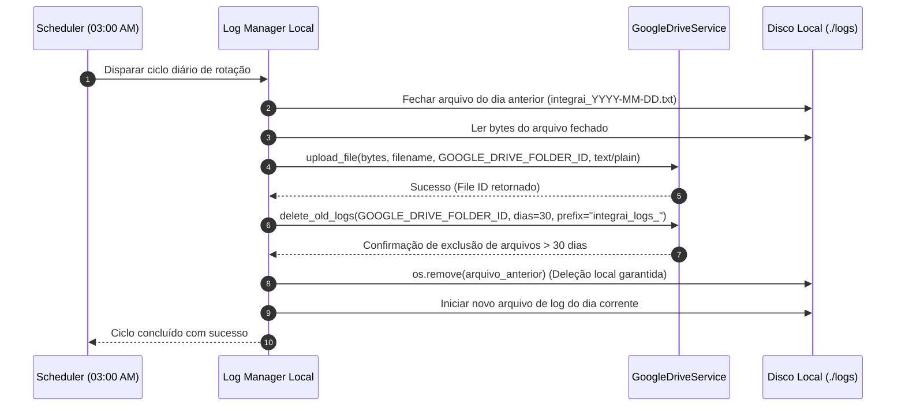

# Design Técnico: Padronização Estruturada de Logs e Ciclo de Vida com Google Drive

**Data:** 2026-10-28  
**Autor:** Antigravity & Equipe ERP IntegraAI  
**Status:** Proposta para Aprovação (Awaiting Approval)  
**Tópico:** Sistema Unificado de Logs, Observabilidade Hierárquica e Sincronização Diária no Google Drive  

---

## 1. Contexto e Motivação (Intent & The Why)

O backend do ERP IntegraAI é composto por múltiplos módulos críticos de alta complexidade: emissão e recepção fiscal (NF-e/DF-e), integrações com marketplaces (Mercado Livre, Shopee, TikTok Shop, Magento), despacho logístico (Intelipost), além de rotas dinâmicas de CRUD genérico e autenticação.

Atualmente, o sistema apresenta os seguintes desafios de observabilidade:
1. **Despadronização de saídas:** Há mais de 150 chamadas de `print()` soltas no código (especialmente no `nfe_service.py` e `crud_user.py`), sem nível de severidade, sem marcação de tempo formal e sem identificação uniforme da origem.
2. **Dificuldade de depuração em produção:** Quando uma integração falha ou a SEFAZ rejeita uma nota, localizar a causa raiz exige vasculhar logs brutos do console Docker, sem códigos de erro explícitos para filtrar.
3. **Ausência de persistência histórica organizada:** Não há rotação diária de arquivos locais de log, nem salvamento automatizado em armazenamento em nuvem para auditoria histórica.

Este projeto visa estabelecer uma **infraestrutura unificada de logging estruturado** que organiza cada registro do nível mais geral ao mais específico, cataloga códigos de erro para busca instantânea, implementa a instrumentação minuciosa função por função em todo o backend e gerencia o ciclo de vida dos arquivos com retenção local de apenas 1 dia (o dia corrente) e retenção de 30 dias no Google Drive às 03:00 da madrugada.

---

## 2. Objetivos, Não-Objetivos e Anti-Objetivos

### 2.1. Objetivos (Goals)
- **G-1: Taxonomia Hierárquica Padronizada (Geral -> Específico):** Todo evento registrado deve seguir a cadeia lógica:  
  `[TIMESTAMP] [NÍVEL] [MÓDULO:SUBMÓDULO:FUNÇÃO] [CÓDIGO_ERRO/STATUS] - Mensagem detalhada | Contexto: {chave: valor}`.
- **G-2: Catálogo Central de Códigos de Erro:** Definir identificadores padronizados (ex: `ERR_NFE_SCHEMA_INVALID`, `ERR_SHOPEE_TOKEN_EXPIRED`, `ERR_AUTH_BAD_CREDENTIALS`, `ERR_DB_INTEGRITY`) para permitir filtros imediatos via grep/scripts/Drive.
- **G-3: Instrumentação Abrangente (Arquivo por Arquivo, Função por Função):**
  - Eliminar 100% dos `print()` dispersos no backend.
  - Adicionar captura estruturada de entrada, saída e exceções em todos os 12 endpoints da API e 11 arquivos de serviço do core, além dos CRUDs e tarefas de inicialização.
- **G-4: Ciclo de Vida dos Arquivos de Log (.txt):**
  - Gravação contínua em arquivo local `./logs/integrai_YYYY-MM-DD.txt`.
  - Agendador diário às 03:00 (horário de Brasília):
    1. Fecha o arquivo de log do dia anterior.
    2. Realiza o upload do arquivo `.txt` para o Google Drive na mesma pasta configurada (`GOOGLE_DRIVE_FOLDER_ID`).
    3. Executa a limpeza de logs no Google Drive, mantendo uma janela deslizante estrita de 30 dias.
    4. Remove o arquivo local do dia anterior do servidor, mantendo no disco local **estritamente apenas o arquivo do dia corrente**.
    5. Inicia e conecta a escrita ao novo arquivo do dia.

### 2.2. Não-Objetivos (Non-Goals)
- Não será construído um painel visual frontend para visualização de logs (os logs são arquivos texto legíveis diretamente no servidor ou no Google Drive).
- Não haverá alteração nos contratos e schemas de resposta da API (a instrumentação é estritamente de observabilidade interna e não quebra clientes da API).
- Não serão contratados nem configurados serviços externos pagos (ex: Datadog, Sentry, Logstash, New Relic).

### 2.3. Anti-Objetivos (Anti-Goals)
- **Vazamento de Dados Sensíveis:** É expressamente proibido registrar em log senhas de usuários, chaves privadas de certificados A1, tokens de API em texto aberto ou payloads com dados de cartão. Todo contexto sensível deve ser mascarado (`***`).
- **Bloqueio do Loop Assíncrono do FastAPI:** A escrita em disco e o upload de logs para o Drive não podem bloquear requisições HTTP da aplicação; operações I/O pesadas e uploads devem ocorrer em executors ou background workers assíncronos.
- **Sobrecarga de I/O em disco:** Apenas logs relevantes (INFO, WARNING, ERROR, CRITICAL) serão mantidos em persistência diária em produção, com granularidade DEBUG ativada sob demanda via configuração de ambiente.

---

## 3. Decisões Acordadas com o Usuário

| Decisão | Definição Acordada | Justificativa |
|---|---|---|
| **Formato e Estrutura** | Geral para específico com código de erro explícito | Facilita a filtragem instantânea por módulo macro ou por categoria de erro |
| **Horário da Rotação** | 03:00 da madrugada (horário de Brasília) | Janela de menor concorrência no sistema, sincronizado com o backup de banco |
| **Retenção Local** | Somente o arquivo do dia corrente | Evita consumo de armazenamento no container/servidor e simplifica inspeção |
| **Retenção no Google Drive** | Janela de 30 dias (purga arquivos anteriores) | Garante histórico para auditoria sem inflar indefinidamente o Drive |
| **Pasta de Destino no Drive** | Mesma pasta do backup (`GOOGLE_DRIVE_FOLDER_ID`) | Centraliza a custódia de dados sem exigir novas variáveis ou pastas |
| **Escopo de Aplicação** | Arquivo por arquivo, função por função em todo o backend | Garante observabilidade total e cobertura uniforme |

---

## 4. Arquitetura Técnica Detalhada

### 4.1. Taxonomia e Formatação dos Logs

O formato padrão em arquivo `.txt` e console será:

```text
[2026-10-28 14:30:15.123] [ERROR] [NFE:NFE_SERVICE:emitir_nfe] [ERR_NFE_SEFAZ_REJEICAO_546] - Falha na validação de ICMS com a SEFAZ | Pedido: 10452 | ChaveRef: 3526... | Detalhe: Rejeicao 546: NF-e de Devolucao com vICMS maior que zero
```

Componentes do registro:
1. `Timestamp`: Data e hora com milissegundos no fuso `America/Sao_Paulo`.
2. `Nível`: `INFO`, `WARNING`, `ERROR`, `CRITICAL`, `DEBUG`.
3. `Origem Hierárquica`: `[MÓDULO : SUBMÓDULO/ARQUIVO : FUNÇÃO]`.
4. `Código de Erro / Status`: `[ERR_DOMINIO_CODIGO]` para erros, ou `[STATUS_OK]`, `[STATUS_PROCESSANDO]` para fluxos informativos críticos.
5. `Mensagem`: Descrição clara e concisa do evento.
6. `Contexto Sanitizado`: Metadados relevantes da transação (IDs, tempos de resposta, payloads higienizados).

### 4.2. Módulo Centralizador de Logging (`app/core/logger.py`)

Será criado o utilitário central que encapsula o `logging` nativo do Python com:
- **`IntegraLogger`**:
  - `StreamHandler`: Emite saídas no console (stdout) para permitir o acompanhamento via `docker logs -f erp_api`.
  - `RotatingDayFileHandler`: Gerencia o arquivo do dia corrente localizado em `./logs/integrai_YYYY-MM-DD.txt`.
- Métodos auxiliares de alta produtividade:
  ```python
  log_info(modulo, arquivo, funcao, status, mensagem, context=None)
  log_warning(modulo, arquivo, funcao, codigo, mensagem, context=None)
  log_error(modulo, arquivo, funcao, codigo, mensagem, exc=None, context=None)
  ```
- **Mascarador de dados sensíveis (Data Sanitizer):** Função interna que remove chaves como `password`, `senha`, `token`, `secret`, `access_token`, `refresh_token`, substituindo seus valores por `[PROTEGIDO]`.

### 4.3. Catálogo de Códigos de Erro (`app/core/error_codes.py`)

Constantes agrupadas por domínio:
- **Autenticação (`AUTH`):** `ERR_AUTH_INVALID_CREDENTIALS`, `ERR_AUTH_TOKEN_EXPIRED`, `ERR_AUTH_INSUFFICIENT_PERMISSIONS`, `ERR_AUTH_USER_NOT_FOUND`.
- **Nota Fiscal & SEFAZ (`NFE` / `DFE`):** `ERR_NFE_CERT_INVALID`, `ERR_NFE_SCHEMA_VALIDATION`, `ERR_NFE_SEFAZ_COMMUNICATION`, `ERR_NFE_SEFAZ_REJECTION`, `ERR_NFE_DANFE_GENERATION`, `ERR_NFE_CANCELAMENTO_FAILED`.
- **Shopee (`SHOPEE`):** `ERR_SHOPEE_AUTH_FAILED`, `ERR_SHOPEE_TOKEN_REFRESH`, `ERR_SHOPEE_API_TIMEOUT`, `ERR_SHOPEE_ORDER_SYNC`, `ERR_SHOPEE_TRACKING_FAILED`.
- **Mercado Livre (`MELI`):** `ERR_MELI_AUTH_EXPIRED`, `ERR_MELI_ORDER_FETCH`, `ERR_MELI_STATUS_SYNC`, `ERR_MELI_LABEL_PRINT`.
- **Magento (`MAGENTO`):** `ERR_MAGENTO_API_ERROR`, `ERR_MAGENTO_STATUS_UPDATE`, `ERR_MAGENTO_STOCK_SYNC`.
- **Intelipost (`INTELIPOST`):** `ERR_INTELIPOST_QUOTE_FAILED`, `ERR_INTELIPOST_DISPATCH_FAILED`, `ERR_INTELIPOST_TRACKING_UPDATE`.
- **AtendAI & TikTok (`ATENDAI` / `TIKTOK`):** `ERR_ATENDAI_WEBHOOK_FAILED`, `ERR_TIKTOK_API_ERROR`.
- **CRUD Genérico & Banco (`GENERIC` / `DB`):** `ERR_DB_CONNECTION_TIMEOUT`, `ERR_DB_INTEGRITY_VIOLATION`, `ERR_GENERIC_RECORD_NOT_FOUND`, `ERR_GENERIC_INVALID_FIELD`, `ERR_TRIGGER_EXECUTION_FAILED`.
- **Sistema & Drive (`SYSTEM` / `DRIVE`):** `ERR_DRIVE_UPLOAD_FAILED`, `ERR_DRIVE_CLEANUP_FAILED`, `ERR_LOG_ROTATION_FAILED`.

### 4.4. Mecânica de Rotação, Upload e Limpeza (`app/core/service/log_service.py`)

O agendador existente (`backup_service.py`) já calcula com precisão a espera diária até as 03:00 (horário de São Paulo). Unificaremos ou coordenaremos essa rotina com `log_service.py`:



**Regra Estrita de Armazenamento:**
- No disco local: **Apenas o arquivo do dia corrente** permanece na pasta `./logs/`.
- No Google Drive: Arquivos dos últimos **30 dias** são preservados na mesma pasta de backup do ERP.

---

## 5. Mapeamento de Arquivos e Escopo de Instrumentação

Para assegurar cobertura total "função por função", o plano dividirá a implementação nos seguintes blocos:

### Bloco 1: Infraestrutura Central
- `app/core/error_codes.py`: Criação do catálogo mestre de erros e status.
- `app/core/logger.py`: Implementação do formatador hierárquico, handlers (console + arquivo) e sanitizador.
- `app/core/service/log_service.py`: Implementação da lógica de rotação, upload, deleção local e purga de 30 dias no Drive.
- `app/core/service/google_drive_service.py`: Ajuste para suportar deleção seletiva por prefixo de log (`integrai_logs_`) e extensão `.txt`.
- `app/main.py`: Conexão do novo logger na inicialização do FastAPI e disparo do scheduler de logs às 03:00.
- `docker-compose.yml`: Adição do volume `./logs:/app/logs` para persistência dos logs no host Windows.

### Bloco 2: Endpoints da API (`app/api/v1/endpoints/`)
1. `generic.py`: Instrumentar funções de CRUD dinâmico (`read_data`, `create_data`, `update_data`, `delete_data`), triggers de automação, sincronização de pedidos e webhook listeners.
2. `nfe.py` e `dfe.py`: Instrumentar emissão, cancelamento, inutilização, consulta de status e download de DANFE.
3. `auth.py`: Instrumentar autenticação de credenciais, geração de tokens, refresh e validação de permissões.
4. `dashboard.py`: Instrumentar consultas consolidadas, relatórios e KPIs financeiros/vendas.
5. `metadata.py`: Instrumentar leitura de metadados, schema de tabelas e configurações de usuário.
6. `shopee.py`: Instrumentar autenticação OAuth, callbacks de autorização, webhooks de pedidos e notificações.
7. `mercadolivre.py`: Instrumentar autenticação OAuth, sync de pedidos e notificações de envio.
8. `magento.py`: Instrumentar chamadas de sincronização de catálogo e pedidos.
9. `intelipost.py`: Instrumentar cotação de frete, criação de pedidos de envio e webhooks de rastreio.
10. `atendai.py`: Instrumentar webhooks e chamadas de integração com IA de atendimento.
11. `tiktok.py`: Instrumentar sync de pedidos e produtos TikTok Shop.

### Bloco 3: Camada de Serviços Core (`app/core/service/`)
1. `nfe_service.py`: Substituição completa de todos os `print()` por logs categorizados (construção de XML, assinatura digital, envio SEFAZ, retorno de protocolo, geração de DANFE e validações de tributação/DIFAL).
2. `shopee_service.py`: Logs detalhados de requisições HTTP, paginação de pedidos, tratamento de refresh token expirado e uploads de rastreio.
3. `meli_service.py`: Logs de chamadas à API do Mercado Livre, renovação de tokens e erros de envio.
4. `magento_service.py`: Logs de comunicação com a loja Magento e mapeamento de atributos.
5. `intelipost_service.py`: Logs de cotação e postagem de etiquetas.
6. `atendai_service.py` e `tiktok_service.py`: Logs de comunicação externa e tratamento de falhas.
7. `elastic_email_service.py`: Logs de disparos de e-mails transacionais e notificações.
8. `backup_service.py` e `google_drive_service.py`: Logs da execução de backup do banco e sincronismo com o Drive.

### Bloco 4: Camada de Dados e CRUD (`app/crud/` e `app/core/db/`)
1. `crud_user.py`: Substituir `print()` por logs estruturados de auditoria de login e falhas de senha.
2. `crud_generic.py` e `crud_business.py`: Logs de operações de escrita e queries críticas.
3. `sync.py`: Logs da sincronização inicial de schemas e colunas do PostgreSQL.

---

## 6. O que Fica a Critério do Desenvolvedor (Builder's Discretion)

1. **Estrutura interna dos Enums/Dicionários de Erro:** O construtor pode organizar os códigos de erro em Enums do Python ou classes de constantes, desde que os nomes e prefixos sigam a especificação.
2. **Formatação de Cores no Terminal:** Para o output do terminal (`stdout`), o construtor pode aplicar cores ANSI (ex: Vermelho para ERROR, Amarelo para WARNING, Verde para INFO) para tornar o `docker logs` ainda mais agradável visualmente.
3. **Nomenclatura do arquivo no Drive:** O arquivo pode ser salvo com nome `integrai_logs_YYYY-MM-DD.txt`, permitindo rápida identificação em ordem cronológica alfabética na pasta do Google Drive.
4. **Tratamento de Exceções Não Capturadas (FastAPI Exception Handler):** O construtor pode adicionar um middleware/handler global no FastAPI (`HTTPException` e `Exception`) para capturar qualquer falha 500 não tratada e registrá-la automaticamente com código `ERR_SYSTEM_UNHANDLED_EXCEPTION`.

---

## 7. Critérios de Validação e Verificação

1. **Verificação de Inicialização:** A API deve iniciar sem erros, criando a pasta `./logs/` e o arquivo do dia `integrai_YYYY-MM-DD.txt`.
2. **Verificação de Registro Estruturado:** Disparar requisições de teste (ex: login com senha errada, consulta a endpoint inválido, teste de emissão) e verificar se o log no console e no arquivo `.txt` contém a taxonomia exata `[TIMESTAMP] [NÍVEL] [MÓDULO:SUBMÓDULO:FUNÇÃO] [CÓDIGO_ERRO]`.
3. **Verificação do Sanitizador:** Garantir que requisições com senhas ou tokens não exibam esses dados em texto puro no arquivo `.txt`.
4. **Verificação da Rotação e Drive:** Testar a função de rotação forçando o encerramento do dia, validando o upload no Google Drive, a exclusão do arquivo antigo no disco local e a preservação do arquivo do dia atual.
